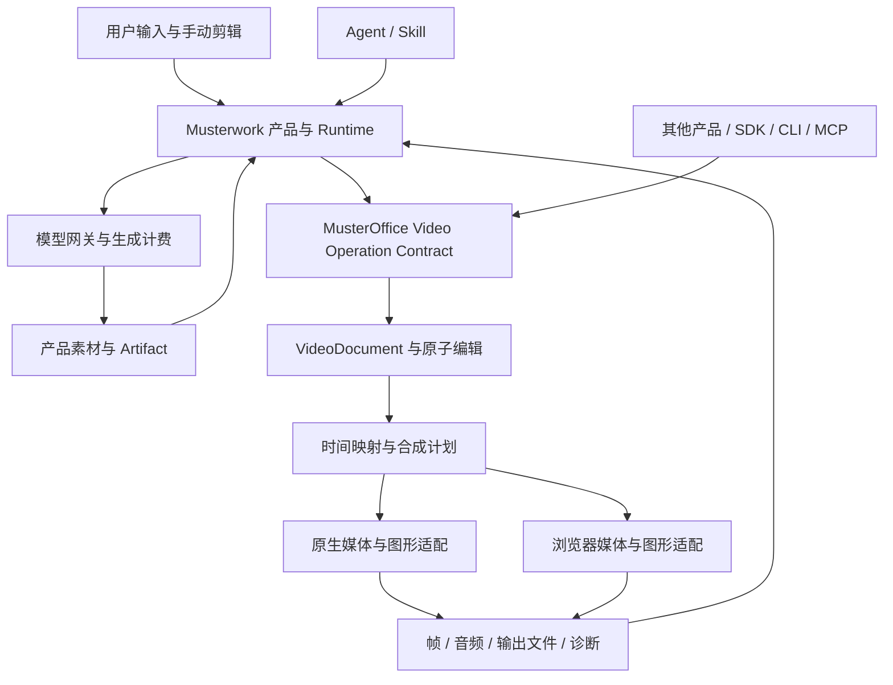

# MusterOffice Video：面向 Agent 的视频创作与剪辑设计方案

- 版本：1.0，2026-10-06。
- 状态：完整目标已获用户开发授权，部分时间、领域模型及原子编辑源码正在落地；尚未完成整体产品验收。基础决定见 [ADR 0012](../decisions/0012-agent-video-domain.md)，实际范围与证据见[实施记录](../implementation/video-editing-progress.md)。
- 产品目标：从素材生成、导入、理解、剪辑到人工调整、本地导出，形成同一可编辑工程上的闭环。
- 交付格式：Markdown。本文为总入口；[技术规格](video-editing/technical-spec.md)规定数据、算法与执行合同；[调研与源码证据](../research/video-editing-2026-10-06.md)记录依据、反证和局限；[验收规格](video-editing/acceptance.md)规定完成条件。
- 现有边界：[架构](../architecture/overview.md)、[ADR 0007](../decisions/0007-kernel-only-integration-boundary.md)、[工程规范](../../AGENTS.md)。本方案扩展第二领域，不改变演示文稿当前验收范围。

## 1. 决策摘要

采用 **MusterOffice 自有视频工程模型、编辑计算和合成调度内核，复用成熟底层媒体组件** 的架构。Rust 承担领域语义、事务、时间映射、编译计划和公共计算；原生和浏览器分别接入媒体设备与文件。Musterwork 负责 Agent、模型配置与计费、任务持久化、权限、文件和交互。

第三方研究改变了部分先前判断：Remotion 已有客户端渲染；火山引擎 AI MediaKit 有官方 Web 剪辑 SDK，其公开集成指南描述的是服务端异步合成；CE.SDK 也有无界面及原生入口。它们都是有效替代路线。选择自研的依据是公开可控的工程语义、与现有办公内核一致的边界、Agent 与人工共用的可靠操作，以及本地执行目标；不是笼统认定第三方能力不足。[研究结论与反证](../research/video-editing-2026-10-06.md#2-会改变选型的研究结论)

最接近目标的参考包括 OpenChatCut 的实际 Agent/MCP 编辑闭环，以及 OpenCut 正在进行的 Rust 核心重写。我们的设计不宣称这些思路为独创；改进要求落实在原子持久提交、可证明的恢复边界、跨端媒体质量和完整依赖体积上。计划中的能力与已经实现的源码分别记录在[研究第 4 节](../research/video-editing-2026-10-06.md#4-源码阅读具体学习什么怎样改进)。

| 决策 | 本方案选择 | 依据和约束 |
| --- | --- | --- |
| 产品归属 | MusterOffice 的第二领域 `Video` | 与 `Presentations` 并列，独立模型、模块与发行闭包 |
| 权威工程 | 自有、版本化、声明式 VideoDocument | 支持稳定对象身份、事务、可检查操作、长期迁移 |
| 编辑入口 | Agent、SDK、MCP、CLI、用户操作共用领域操作 | 避免脚本、UI 和渲染各自解释剪辑语义 |
| 计算位置 | Desktop Native / Browser Local | 默认不部署视频渲染集群，不隐式上传本地素材 |
| 媒体基础 | 原生受控 FFmpeg 库；浏览器 Mediabunny + WebCodecs | 底层适配可替换，不取得工程权威 |
| 图形基础 | 自有合成计划；原生 wgpu，浏览器 WebGPU；明确的 CPU 参考实现 | 共享效果数学与测试；平台纹理互操作需要实测 |
| 音频基础 | 共享混音和自动化；成熟重采样/时伸组件 | 补偿算法延迟，定义精确样本边界 |
| 产品 UI | Musterwork 自有组件、布局与设计变量 | 默认播放器简洁，主动进入剪辑后显示时间线 |
| 外部编辑器 | OTIO/FCPXML 等交换与明确版本适配 | 报告损失，不宣称所有特效无损往返 |
| 第三方商业 SDK | 对照与可选集成，不作为默认内核依赖 | 不把商业私有工程作为唯一保存格式 |

“一步到位”落实为完整目标、统一架构和完整验收。工程按依赖次序实现，但三个片段的演示、包装层接通或一次导出都不能替代交付。

## 2. 产品定位与成功标准

### 2.1 用户要完成的工作

主要场景是产品介绍、营销短片、知识讲解、培训视频、录屏整理、口播及演示文稿转视频。用户提供需求和素材，Agent 完成组织与剪辑，用户随时接续调整。相同内核也可供其他 Agent 产品独立调用。

完整体验应满足：

1. 在对话中 `@视频创作`，输入文字并附上视频、音频或图片，选择 Auto 或具体视频模型。
2. Agent 检查素材与可用能力，按需要生成补充素材、识别语音、组织镜头、编辑工程。
3. 消息下面出现视频文件卡片或可编辑工程入口；点击右侧直接播放。
4. 用户进入剪辑，拖动、裁切、改字幕、调音量，Agent 后续读取到的是这些最新修改。
5. 导出在用户设备完成；用户继续修改工程时，已经开始的导出保持绑定原版本。
6. 重启、断网、切换对话、取消任务及模型调用失败后，已保存工程仍可恢复。

成功不仅是产出 MP4，还包括工程可继续编辑、输出符合用户意图、失败可解释、计费可追踪及跨端边界真实可用。

### 2.2 范围边界

本次最终交付覆盖下表全部“必须”项。电影级三维合成、完整 DAW、任意第三方插件宿主、实时多人 CRDT、专业多机位导播、DRM 解密不是本次完成的前置条件；协议为它们保留扩展能力，不能显示为已支持。

| ID | 产品要求 | 级别 | 核心验收点 |
| --- | --- | --- | --- |
| PR-01 | 技能激活后的模型与参数配置 | 必须 | 未选技能不出现视频参数；Auto 无伪装成手动值的控件 |
| PR-02 | 图片、音频、视频输入与角色 | 必须 | 素材、参考图、首尾帧、参考视频、配音等按实际模型能力约束 |
| PR-03 | 生成素材进入同一项目素材库 | 必须 | 可重用、可溯源、与生成任务及原消息关联 |
| PR-04 | 非破坏性的多轨工程 | 必须 | 原素材不变；分割、移动、修剪、插入、覆盖、波纹、滚动、滑移、滑动均有明确语义 |
| PR-05 | 音画关联、轨道锁定与成组编辑 | 必须 | J/L cut、音画分离、锁定冲突与关联移动可预测 |
| PR-06 | 图形与运动 | 必须 | 位置、裁剪、旋转、透明度、层级、遮罩、关键帧、基础转场与调色 |
| PR-07 | 时间处理 | 必须 | 混合帧率/VFR、定格、正反播放、恒速与分段变速；不靠错误的平均帧率定位 |
| PR-08 | 音频 | 必须 | 多轨、静音/独奏、声道映射、增益、淡入淡出、配乐压低、保调变速、响度检查 |
| PR-09 | 字幕与文本剪辑 | 必须 | SRT/VTT、文字样式、词级时间锚点；改错字与删除媒体分开操作 |
| PR-10 | 素材理解与检索 | 必须 | 缩略图、波形、语音文本、场景候选；分析来源和置信度可追溯 |
| PR-11 | Agent 完整编辑能力 | 必须 | 查询、准备原子修改、提交、预览、检查、导出；提供有界结构化结果 |
| PR-12 | 人机共享版本和历史 | 必须 | 人工编辑不被 Agent 覆盖；重试不重复编辑；撤销不误撤别人的新修改 |
| PR-13 | 轻量播放器与独立编辑状态 | 必须 | 默认播放/进度/下载，进入剪辑再显示工作区 |
| PR-14 | 本地可靠保存与搬迁 | 必须 | 缺失素材可重连；可导出包含资源的工程包；不把浏览器缓存当永久备份 |
| PR-15 | 本地导出 | 必须 | 固定版本、进度、取消、错误、输出验证和文件卡片；视频导出中仍可编辑 |
| PR-16 | 跨端能力 | 必须 | 同一工程、操作与诊断；设备不支持的 codec 不静默换成云处理 |
| PR-17 | 多会话状态 | 必须 | 非当前对话也正确反映运行、待处理、完成、失败与未读 |
| PR-18 | 模型管理和计费 | 必须 | 发布配置不可变、组合能力校验、成本与用户积分分账、未知结果可对账 |
| PR-19 | 外部互操作 | 必须 | 定义 OTIO/FCPXML 支持子集与损失报告；工程自身往返无损 |
| PR-20 | 诊断、资源限制和模块分发 | 必须 | 任一输入不能无限占用内存；组件可定位、可固定、可取消 |

## 3. 产品交互

### 3.1 对话输入框

`@视频创作` 是加载整组工具的唯一产品开关。能力包括生成图片、生成视频、素材检查/分析、视频编辑；声音生成/ASR 是可选服务能力，未配置时不能伪称可用。

- 未选择技能：沿用现有输入框，不展示视频模型或视频参数。
- 选择技能：出现一行模型选择，默认 `Auto`；附件区域允许图片、视频、音频。移除技能收起控件，保留本会话草稿，发送时不携带失效的隐藏约束。
- Auto：Agent 在管理员允许的模型集合和实际可用参数组合内选择；无需让用户面对分辨率等设置。预算、输入兼容和用户文字约束仍必须遵守。
- 指定模型：展示该模型可用的时长、画幅、分辨率、音频开关；字段相互约束，不显示不能提交的笛卡尔积。少量选项可直接选择；高级项折叠。
- 附件角色：卡片右上角显示“素材/参考图/首帧/尾帧/参考视频/配音”等用途，默认按任务合理匹配，存在歧义时再向用户确认。剪辑素材无须符合生成模型的参考输入限制。
- 发送冻结 `skillVersion + selection + catalogRevision + inputBindings`。编辑重发可改变设置；重试与委派继承既有用户意图，不能暗中换模型、规格或参考输入。
- 没有生成模型时，已有素材仍可剪辑。不能因为 Auto 列表为空而禁用整个技能；只有需要生成视频的步骤显示未配置原因。

聊天推理模型支持哪些直接输入，与工具可以读取哪些素材是两套能力。不能因为当前聊天模型不收视频而禁止视频附件进入已授权的剪辑工具。

### 3.2 文件卡片与右侧播放器

消息卡片显示封面、名称、时长、生成中/已完成等必要状态。文件保存到现有 Artifact 体系；卡片关联不可变文件版本，可追溯到工程和生成任务。

点击后：右侧标题栏显示名称、关闭；主体为视频；底部提供播放/暂停、进度拖动、当前时间/总时长、音量、全屏以及下载。`剪辑` 是清晰但次要的入口。不展示 provider request ID、codec 后端、缓存命中率或计费内部状态。

失败时显示用户能采取的动作，例如“这台设备无法播放此格式，可下载或在桌面打开”，技术诊断放在可展开详情中。若导出仅在某台设备存在，其他设备卡片明确标注文件位置与可用性，不能展示虚假的下载链接。

### 3.3 编辑工作区

沿用 Musterwork 的导航、对话区、右侧面板及设计变量，不引入另一套网站外壳。进入剪辑后右侧可扩展宽度，保留对话作为指令入口。

已检查当前候选组件使用的 `@musterwork/design-system` 按钮/选择器及 `--bg-primary`、`--bg-secondary`、`--text-primary`、`--text-secondary`、`--text-tertiary` 等变量。正式界面继承这些主题资源、焦点和禁用状态；时间线片段的颜色仅表达媒体类别/选中状态，不能另造高饱和的整页主题。此处为交互规格，尚未交付新内核对应的运行原型。

```text
原有导航 │ 对话与 Agent 回复 │ 工程名            撤销/重做  导出  关闭
         │                  │ ┌──────────────────────────────┐
         │                  │ │             预览             │
         │                  │ └──────────────────────────────┘
         │                  │       播放     时间     音量
         │                  │ 素材 / 字幕       选中对象的必要属性
         │                  │ 视频轨 ──[镜头一]──[镜头二]─────
         │                  │ 字幕轨 ──[字幕]────────────────
         │ @视频创作 输入框 │ 音频轨 ──[配音]────────────────
```

- 默认只展开必要轨道。新增素材、字幕和音频时再出现对应轨道。
- 素材栏可收起，属性栏随选择出现，避免播放器被多列面板挤占。
- 时间线支持水平缩放/滚动、吸附、框选、键盘微调、剪切、撤销。吸附反馈是短暂参考线；拖动中显示候选状态，松手提交一次历史操作。
- 选中片段可“让 Agent 修改”，输入框引用稳定片段 ID 与选中范围；用户可读标签不暴露内部标识。
- Agent 一组修改作为一个可撤销步骤。正在手动拖动时不跳动时间线；相关 Agent 修改提交遇到冲突须重读，不能抢夺当前交互。
- 字幕列表支持改字、断句、时间调整；删除文字默认只修改字幕，明确选择“删除对应片段”才剪媒体。
- 波形、缩略图和代理素材是渐进可用的辅助数据；生成它们不会阻塞基本编辑，也不会变成新增聊天消息。
- 窄面板优先预览和时间线，素材/属性作为切换面板。按钮、焦点、字幕编辑与时间线需有键盘和辅助技术支持。

### 3.4 导出与恢复

常规导出只要求文件名、画幅/分辨率、质量；高级选项再暴露帧率、容器/编码及音频。默认值由工程和本机能力确定。重新选择规格不得改变工程内容。

“正在导出 42%”绑定固定工程版本；修改工程后不重启原导出。取消后释放媒体句柄并回收未完成输出。成功后验证时长、音视频流、可解码性，再生成正式文件卡片。

关闭右侧面板可继续任务；关闭浏览器页面则不能保证继续计算。浏览器保存已完成分段和恢复信息，下次打开后重新校验并续作或重算未完成部分。桌面任务由原生宿主持有，不依赖前端窗口存在；应用退出策略由现有任务生命周期统一管理。

## 4. 架构与职责



| 责任 | MusterOffice | Musterwork |
| --- | --- | --- |
| 编辑工程 | 模型、校验、稳定身份、迁移、原子计算 | 工程归属、保存、历史提交、授权 |
| 渲染 | 合成计划、效果、时间、输出校验 | 资源句柄、任务持久化、取消、设备选择 |
| Agent | 标准 Schema、语义工具、诊断与 Skill 方法 | 推理、技能装载、授权与预算、运行状态 |
| 模型服务 | 接收已经授权的媒体资源 | provider 协议、密钥、生成任务和结算 |
| UI | 无界面预览/播放及编辑计算接口 | 对话、卡片、时间线、播放器与交互 |
| 文件/网络 | 显式资源输入与有界输出，不自行联网 | 本地/云端存储、上传授权、数据通道 |
| 发布 | 模块、版本、资源闭包和公共发行物 | 固定版本消费、组件安装、渠道与回滚 |

所有绘制和计算回调都遵守已有纯计算边界；宿主适配层可以访问已授权句柄，领域核心不能读取任意路径、凭证或系统隐式字体。

### 4.1 两层“真相”与一个工程

内容真相是不可变 VideoDocument 快照；业务真相是宿主持有的工程 head、操作回执、任务和 Artifact 提交记录。渲染缓存、缩略图、播放器对象和 GPU 资源都可重建，不得成为唯一保存状态。

同一工程只有一个当前权威 head。桌面本地由 Device Runtime 持有；浏览器本地由产品 Browser Project Host 持有。云端 Agent 是调用者，通过现有受授权执行通道请求本地计算；服务器不另存一个同时可写的“编辑真相”。跨设备迁移必须显式交接或分叉，不能仅靠广播消息假装同步。

### 4.2 多端界限

| 能力 | 桌面端 | Web 端 | 服务器 |
| --- | --- | --- | --- |
| 工程编辑/检查 | 原生内核 | WASM 内核 | 可转发命令及保存用户选择同步的元数据 |
| 预览与导出 | 本机 Worker | 浏览器 Worker | 默认不渲染 |
| 长任务恢复 | 宿主持久任务与输出检查点 | 页面恢复后重连，检查本地资源与分段 | 保存已有业务任务状态，不冒充在线设备 |
| 文件访问 | 用户授权文件、产品内容库 | 上传控件/授权句柄/OPFS | 仅处理明确上传或原有云端素材 |
| 生成/ASR 等模型 | 本地或获授权远端服务 | 通过产品受控服务 | provider 适配、密钥与计费 |
| 本地设备不具备能力 | 明确诊断或安装声明模块 | 可保存工程并在桌面打开 | 不自动开云渲染 |

“本地剪辑”不会消除模型生成服务费用，也不代表跨设备同步不需要存储和流量。设计将这些成本分开呈现。默认只增加轻量的控制与可选元数据持久化，不新增常驻 GPU/视频编码服务。

## 5. 技术选型与原有基础收敛

### 5.1 自研与复用的具体范围

| 子系统 | 建议实现 | 为什么这样分工 |
| --- | --- | --- |
| 工程模型/操作/历史计算 | Rust 原创实现 | 这是 Agent 可靠编辑与跨端一致性的关键资产 |
| 时间索引/剪辑编译/任务图 | Rust 原创实现 | 同一套可验证语义，便于增量失效和设备调度 |
| 原生读写/解码/编码 | FFmpeg `libavformat/libavcodec/libswresample` 受控构建与窄 FFI | 复用成熟媒体基础；禁止把任意命令字符串当编辑协议 |
| 浏览器容器与样本 I/O | Mediabunny 经审计的固定版本 + WebCodecs | 保留复杂媒体边界处理；MPL-2.0 按具体发行闭包处理 |
| 合成 | Rust 生成 RenderPlan + 版本化效果；原生 wgpu/浏览器 WebGPU | 图形设备差异止于适配层，文字与效果数学共用 |
| 文本 | 复用 MusterOffice 字体塑形和布局基础 | 中文、多语、字幕预览与导出保持一致 |
| 音频保调变速 | Signalsmith Stretch 为优先候选，窄 C ABI 与 Native/WASM 验证 | 原作者公开延迟模型及 MIT 许可；质量与各平台构建仍需验证 |
| 外部交换 | 自有导入导出映射，OTIO/FCPXML 对照校验 | 不把交换格式的未定义行为带进内部权威模型 |
| 智能分析 | 可插拔、显式权限的本地/远端分析器 | ASR/镜头建议不进入确定性编辑核心 |

组件事实及许可见[研究证据](../research/video-editing-2026-10-06.md)。这些是推荐组合，不能据此宣称原生纹理零拷贝、浏览器全格式、二进制体积或跨平台音质已经验证。

### 5.2 必须处理的既有架构问题

现有 `mo-common::RationalTime` 已有整数字符串 ticks、timescale 和精确比较，可复用其基本约束。现有 `mo-timeline` 含 PPT 的点击组、动画树与页面导航，不直接扩成视频多轨模型。现有 `mo-kernel-api` 和 `mo-wasm` 仍强关联演示文稿依赖，不能让视频入口强带 PPT 导入导出、模板和全部资源。

实施时保持既有 PPT 公共合同，抽出真正通用的标识、预算、诊断与协议封装；视频使用独立入口与模块。共用文本/图形原语时梳理依赖方向，不能通过跨仓源码引用或把 PPT Document 当视频工程绕过分层。

推荐职责单元详见[技术规格第 2 节](video-editing/technical-spec.md#2-模块与依赖)。模块数以实际职责和依赖边界为准，不为每个结构体建立 crate。

## 6. 模型管理、素材生成与计费

### 6.1 Admin 独立视频模型配置

视频模型与图片模型分别管理，共用 provider 凭证和注册表基础设施。配置分成模型身份、协议适配、能力组合、策略与价格，不能用一个“OpenAI compatible”布尔值掩盖不同异步视频协议。

| 字段组 | 字段 | 校验/发布规则 |
| --- | --- | --- |
| 身份 | `modelKey`, 名称, 描述, `providerKey`, 上游模型/端点 ID | 公共模型 key 与私有 provider 标识分离 |
| 连接 | `adapterId/version`, base URL, credential reference | 凭证只存在服务端；允许地址和网络出口校验 |
| 状态 | 草稿/已发布/停用, 排序, Auto 可选, 租户可见性 | 发布产生不可变 revision；停用阻止新调用，既有任务可对账 |
| 输入能力 | 模态、角色、数量、时长、字节、分辨率、互斥要求 | 首尾帧/参考视频/音频必须组合校验 |
| 输出组合 | preset key、比例、尺寸、时长、帧率、音频开关 | 一个 preset 代表一个有效组合；不凭空拼选项 |
| 参数 | seed、负向提示、镜头参数等受支持字段 | 有类型/范围；未知字段拒绝，不能任意透传 |
| 任务 | 创建/查询/取消/结果协议、超时、限流 | 能否取消必须真实；明确状态不确定的处理 |
| 计费 | 币种、计价单位、分辨率/音频维度、阶梯/舍入、积分规则 | Decimal；价格版本与任务固定；缺失用量不能记为 0 |
| 预算 | 预授权上限、单任务限额、并发配额 | Auto 受相同预算约束 |
| 验证 | 配置检查、协议测试、真实调用证据、可用性 | “字段合法”“连通”“真实能力通过”分开 |

用户挑选模型后，显示该模型有效字段；Auto 模式由 Agent 根据任务类型、输入适配、有效输出组合、预算和策略排序。不能把价格最低当唯一目标，也不能暗中把用户指定模型替换成其他模型。

本次调研聚焦剪辑，**不重新认证 Doubao-Seedance-2.5 或其他生成模型的当前商用可用性与价格**。实际模型条目只有完成官方协议和账号权限验证后才能发布。

### 6.2 生成任务与编辑任务的区别

生成是可能产生费用的外部副作用。剪辑是给定输入、版本与计算档案下的本地计算。它们共享产品任务展示，但不共享错误重试规则。

生成调用固定配置/价格、先保存提交意图；请求发送后响应丢失时进入“不确定”，有任务 ID 则查询，无 ID 则进入对账，不能盲目再次付费创建。provider 实际费用与结果能否下载分账：上游生成成功但交付失败，不应再次创建同一付费任务来修复下载。

本地剪辑不冒充模型调用计费。若产品决定对功能本身收费，应以清晰的权益规则实现，与媒体模型用量账本分开。取消生成不等于上游不收费；界面依据实际服务合同反馈。

生成结果必须进入产品素材/Artifact 管理，得到稳定资源身份和元数据，再插入工程。过期 URL、临时 Blob URL 和 provider 私有地址不是工程资产身份。

## 7. 工程、Agent 与人机协作原则

详细 schema、事务和执行流程见[技术规格](video-editing/technical-spec.md)。总原则如下：

1. 工程持有剪辑决定，素材持有不可变媒体内容，分析结果持有独立来源与版本；三者不能混成一段不可解释的私有 scene 字符串。
2. 帧率使用分数，剪辑时间使用精确 ticks/timescale；源 PTS、解码 DTS、工程时间、音频样本序号分别建模。
3. 剪辑请求先在同一 reducer 的暂存快照上计算候选，宿主基于 head 进行原子提交；预检与提交不能各写一套算法。
4. 人工与 Agent 使用同一操作入口。稳定 ID、版本、读写集合、幂等键、逆操作及资源依赖都在合同中可检查。
5. 对于字幕删除、音画联动、波纹范围等有多种合理解释的操作，必须有显式策略，禁止隐藏的全局默认修改其他轨道。
6. 播放、拖动定位与最终导出消费同一合成语义；预览可用代理/较低分辨率，最终输出不能悄悄降低效果或替换资源。
7. MCP 搬运命令、资源引用与诊断，不逐帧传输原始媒体，也不向模型暴露整个工程或全部字节。

## 8. 性能、体积与质量目标

以下均是**拟定验收预算，不是已测结果**。具体设备、浏览器、输入与资源闭包必须在验收报告登记。若未达到，记录实际失败并优化；不通过缩小素材集或隐藏依赖宣称成功。

| 项目 | 目标预算 | 口径 |
| --- | --- | --- |
| 编辑计算 | 1,000 个片段、8 条轨道下，单片段移动/裁切 p95 ≤ 20 ms | 只计内核计算；另计保存和 UI；100,000 次随机编辑验证不变量 |
| 拖动反馈 | 选中/拖动交互主线程工作 p95 ≤ 8 ms | 缩略图加载不阻塞；拖动是候选预览，松手才提交 |
| 热定位 | 1080p 代理素材随机 seek p95 ≤ 150 ms | 已建索引、已暖缓存；冷定位另报 |
| 冷定位 | 1080p 长 GOP 素材 p95 ≤ 750 ms | 本地 SSD、标注 GOP 与硬件；不能以代理成绩代替 |
| 实时播放 | 1080p30，2 路视频 + 字幕 + 2 路音频，持续 10 分钟掉帧 < 1% | 桌面与浏览器分别验收，低性能设备报告能力档案 |
| 音画同步 | 测量误差目标 ≤ 20 ms，长时间无单向累积漂移 | 同步测试信号、起点/中点/终点、seek 后分别测量 |
| 导出 | 指定硬件 1080p 基础工作负载目标 RTF ≤ 1 | RTF=墙钟时间/成片时长；包含解码、合成、编码、写出与验证 |
| 内存 | 1080p 基础任务媒体工作集目标 ≤ 512 MiB | UI/Electron、媒体工作集、GPU 内存分别计量；4K 单列 |
| 首次加载 | Video semantic WASM 压缩目标 ≤ 3 MiB；基础浏览器编辑功能增量 ≤ 12 MiB | 字体/codec 扩展另外明确展示，不能从完整体积统计里排除 |
| 原生发行 | 视频模块基础安装增量目标 ≤ 80 MiB | 含所选媒体与图形依赖；完整离线字体和扩展档案单列 |
| 取消 | p95 ≤ 1 s 停止新增工作，p95 ≤ 3 s 释放受控资源 | 外部驱动不响应时宿主可终止隔离 worker |

正确性以编辑语义、时间边界、资源身份、文字布局和音频样本数为硬约束；硬件编解码结果的像素/码流不承诺逐字节相同。跨端精确程度由能力档案与验收阈值规定，不能以“跨端像素不完全一致”为理由放过明显颜色错误或丢帧。

## 9. 实施依赖与迁移

| 工作包 | 必须产出 | 依赖 | 退出条件 |
| --- | --- | --- | --- |
| W1 领域与合同 | VideoDocument、时间/资源/操作 Schema、能力档案、错误分类 | 本设计 | Native/WASM 语义向量一致；接口可由独立客户端调用 |
| W2 媒体与合成 | 原生/Web 媒体适配、时间索引、合成计划、音频管线 | W1 | 混合帧率、B 帧、VFR、文字/色彩、音画同步通过 |
| W3 编辑与历史 | 全部基础剪辑操作、候选预览、事务回执、冲突与撤销 | W1 | 随机操作/失败注入/重试/恢复通过 |
| W4 产品执行 | Device/Browser Host、Artifact、现有任务状态、组件发行消费 | W1–W3 | 无跨仓私有依赖；权限、设备断连与后台会话通过 |
| W5 创作与交互 | 技能、生成服务、Admin、计费、素材角色、右侧编辑器 | W3–W4 | 原对话中的完整链路通过，而非孤立演示页 |
| W6 完整验收 | 互操作、性能、内存、发行、安全、真实 provider 测试 | W1–W5 | [验收规格](video-editing/acceptance.md)逐项有证据 |

上述顺序不代表缩减目标。W1–W5 的局部通过只能报告对应能力完成，不能提前宣布本地可验收全功能。

现有 Musterwork 分支中，模型注册、任务、计费、输入框和文件卡片候选实现可在本方案约束下继续整理；CE.SDK 的私有 scene 保存、编辑会话、静态资源与许可初始化应由新内核接管。先清点是否存在真实用户工程：如有，保留原件并提供有损迁移报告/继续打开旧工程的明确路径；不能直接将 opaque scene 改名成新格式。没有真实数据则移除试验链路，避免两套权威长期并存。

本轮对当前候选组件的定点检查还确认了三处收敛要求：

- `ConversationVideoControls` 目前在 Auto 没有可选模型时判视频选择无效；必须区分“生成模型不可用”和“已有素材可剪辑”，对应 UX-05。
- `VideoWorkbench` 当前将导出 Blob 转成临时 URL 用于播放/下载；新流程必须先交给宿主验证、保存并发布正式 Artifact，再提供卡片。组件能播放临时文件不算交付完成。
- `VideoEditor` 当前依赖 `MediaEditorSession` 与第三方引擎挂载。替换时应保留播放器/编辑状态的产品边界，重建基于公共操作的时间线；不能仅在 session 后面换一个库名。

这些是候选代码观察，不表示整个原实现已经验收。实施以公共接口和最终需求为准，不为保留试验代码而改变领域边界。

发布采用独立、不可变 MusterOffice release，清单含视频模块、SDK、Native/WASM、必要字体/codec 与哈希。Musterwork 按既有组件机制固定消费；本地开发也通过显式 release 链接，不引入 sibling Cargo path、源码拷贝或 Git submodule。

## 10. 主要风险与需要被证据回答的问题

| 问题 | 设计应对 | 关闭证据 |
| --- | --- | --- |
| 自研范围大，容易功能多但基础不可靠 | 时间/事务/播放/导出语义先统一，全套完成门禁不变 | 故障注入、真实工程长运行、完整验收矩阵 |
| 原生 GPU 纹理互操作可能仍需复制 | 狭窄平台适配，统计每条路径的复制与同步成本 | macOS/Windows/Linux 各自 profiling；不预先宣称零拷贝 |
| 浏览器 codec、权限、存储差异 | 能力探测、可搬迁工程、明确降级与设备交接 | 不同浏览器实机、离线/清理站点数据测试 |
| 高质量时伸/颜色/字幕跨端差异 | 固定算法与资源档案、参考输出、专门音画测试 | 盲听/样本数、标准色卡、多语字幕与字形对照 |
| Agent 与用户并发写入 | 稳定 ID + CAS + 对象版本 + 有条件逆操作 | 双客户端并发、陈旧重试、撤销冲突用例 |
| 第三方接口/许可改变 | 固定版本和 SBOM、边界可替换、不混入闭源代码 | 构建清单、许可证/来源核查与升级回归 |
| “默认本地”被方便的远端服务绕过 | 数据通道与控制通道分离，外传有明确策略 | 断外网剪辑导出和网络请求审计 |

当前未进行商业 SDK 采购/账号调用，也未编译运行所有开源编辑器，更未完成新的 MusterOffice 视频实现。研究证据可以支持架构决策，不能替代性能、音质、互操作或完整产品验收。
